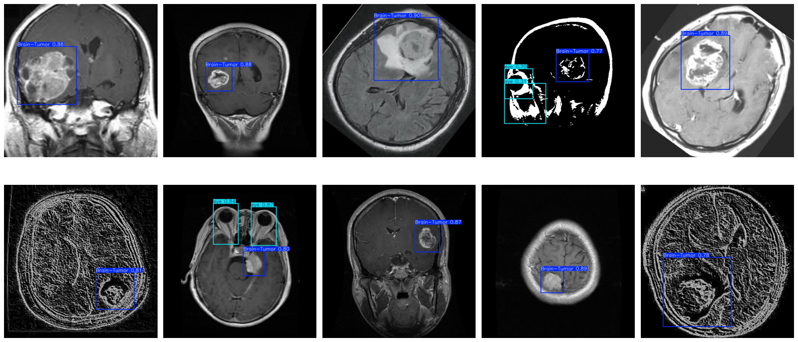

# 🧠 Brain Tumour Detection with YOLO

> Real-time object detection that finds and boxes brain tumors in MRI scans, trained in under 7 minutes on a single GPU, with a drag-and-drop web demo.



<sub>Predictions on held-out validation scans. Blue boxes = tumor, cyan = eye (a second landmark class), with confidence scores.</sub>

---

## 💡 Why this matters

Radiologists review hundreds of scans a day. A fast detector that highlights likely tumor regions can act as a second pair of eyes, helping prioritize scans and reduce the chance that something is missed. This project builds that detector end to end: data, training, evaluation, and an interactive app.

## 📊 Results

Evaluated on **151 held-out validation images** after 25 epochs:

| Class | Precision | Recall | mAP@50 | mAP@50-95 |
|---|---|---|---|---|
| **Brain tumor** | **0.93** | **0.91** | **0.96** | **0.68** |
| Eye | 0.95 | 0.78 | 0.84 | 0.56 |
| All classes | 0.94 | 0.84 | 0.90 | 0.62 |

- ⚡ **~3.4 ms inference per image** on a Tesla T4, fast enough for real-time use
- 🪶 **~3M parameters** (nano model), small enough for modest hardware
- ⏱️ **6.8 minutes** total training time

## 🔧 How it works

```
Roboflow MRI dataset ──► YOLO nano (COCO-pretrained) ──► Fine-tune 25 epochs ──► Evaluate ──► Gradio app
   852 train / 151 val       transfer learning            AdamW, 640px, AMP      P / R / mAP     upload → boxes
```

1. **Data**: brain MRI images with bounding-box labels for two classes (tumor, eye), pulled from Roboflow in YOLO format.
2. **Transfer learning**: starts from a COCO-pretrained nano model, so it learns from only ~850 images.
3. **Training**: 25 epochs at 640×640 with built-in augmentation (mosaic, blur, CLAHE) and mixed precision.
4. **Evaluation**: precision, recall and mAP per class on the validation split.
5. **Demo**: a Gradio interface where you upload a scan and get the annotated result back.

## 🚀 Quick start

Easiest: open `Brain_Tumour_Detection_Using_YOLOv10.ipynb` in Google Colab with a GPU runtime and run all cells.

Locally:

```bash
pip install ultralytics roboflow gradio
export ROBOFLOW_API_KEY=your_key_here
jupyter notebook Brain_Tumour_Detection_Using_YOLOv10.ipynb
```

Run a trained model on your own image:

```python
from ultralytics import YOLO
model = YOLO("runs/detect/train/weights/best.pt")
model.predict("my_scan.jpg", conf=0.25, save=True)
```

## 🧰 Tech stack

Python · Ultralytics YOLO · PyTorch · Roboflow · Gradio · Matplotlib · Google Colab (T4 GPU)

## 🔭 What I'd do next

- Add more tumor types (glioma, meningioma, pituitary) as separate classes
- Use k-fold validation and a separate test set for a more robust estimate
- Deploy the Gradio app permanently on Hugging Face Spaces
- Add Grad-CAM style visual explanations so clinicians can see *why* the model flagged a region

## ⚠️ Disclaimer

This is a research and learning project, not a medical device. It is not intended for clinical diagnosis.

---

<sub>Built by [Shweta Smriti Tripathi](https://www.linkedin.com/in/shweta-smriti-tripathi/) · feedback welcome via issues</sub>
